
United Kingdom | Home Office statistics | June 2026 edition

The Home Office recorded **101,911 people claiming asylum in calendar year 2025**. The latest rolling-year figures in this edition cover the year ending June 2026: 85,891 people claimed asylum, 115,872 received an initial decision, and 40,168 people were waiting for an initial decision at the end of June.

::: {.metric-row}
::: {.metric-card}
101,911
People claiming asylum in calendar 2025
Calendar-year flow; people, not cases
:::

::: {.metric-card}
38.1%
Published initial grant rate
Year ending June 2026; main applicants
:::

::: {.metric-card}
40,168
People awaiting an initial decision
June 2026; 32,401 main applicants and 7,767 dependants
:::
:::

:::: {.metric-row .wip}
:::: {.metric-card}
224,742
Cases in work in progress
Latest published snapshot: June 2024; main-applicant cases
::::

:::: {.metric-card}
137,525
Beyond the initial-decision stage
61.2%; published as “Post Decision”, with no further breakdown
::::

:::: {.metric-card}
87,217
Cases awaiting an initial decision in WIP
Main-applicant cases; 38.8% of WIP in June 2024
::::
::::

:::: {.callout-note}
### What has happened to the WIP queue since June 2024?

**The current total WIP is not published.** The Home Office’s latest full count remains **224,742 main-applicant cases in June 2024**; table `ASY_03` is suspended after that date. Its **137,525 “Post Decision” cases** had moved beyond an initial decision, but the June 2024 table does not break them down further. They should not all be described as waiting for appeals or reviews, and “Post Decision” does not mean the cases were resolved. The Home Office’s Note 25 cautions that this aggregate is inflated by cases for which a decision had already been served.

The initial-decision queue did fall by more than half: Home Office table `ASY_02` reports **87,217 applications in June 2024** and **33,514 in June 2026**, a **61.6% decrease** in that series. The separate `D03` count for June 2026 is **40,168 people**, including **32,401 main-applicant cases** and dependants; the tables are separately compiled, so use the same series for a trend rather than treating these figures as interchangeable.

Meanwhile, the Ministry of Justice recorded **90,341 open cases in its Asylum/Protection and Revocation of Protection caseload in June 2026**, up from **33,227 in June 2024**. That increase is larger than the fall in the initial-decision queue, but the figures are not linked case by case and cannot be added to estimate WIP. They show substantial work further along the process; **the current total WIP could be higher or lower than June 2024, and the published data do not establish which**. [See the caseload comparison below](#backlog-and-waiting-times).
::::

## The overall picture

Calendar-year flows and rolling years answer different questions. The 2025 calendar-year series is shown through 2025; the year ending June 2026 is reported separately, not treated as a calendar 2026 value. In that latest rolling year, 85,891 people claimed asylum and 115,872 received an initial decision. Those decisions comprised 42,394 grants of protection or other leave and 73,478 refusals.

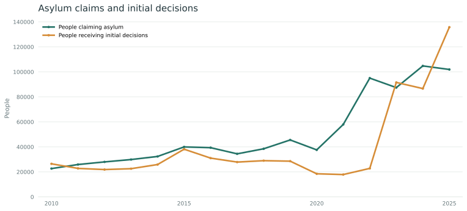{fig-alt="Two lines show annual asylum claims and initial decisions from 2010 to 2025, with a large rise in recent years and fewer claims in 2025."}

The Home Office reports its initial grant rate directly. It was **42.1% in calendar 2025** and **38.1% in the year ending June 2026**. The published rate applies to **main applicants** and includes protection or other leave; it is not recalculated here from counts that include dependants.

{fig-alt="A line chart shows the Home Office published main-applicant initial grant rate from 2010 to 2025."}

The latest pending headline is **40,168 people**, or **32,401 cases**, awaiting an initial decision. They are different units and must not be added together. This stock is not a measure of all people involved in every stage of the asylum process.

## Who claims asylum?

Tables `Asy_01a` and `Asy_01b` break claims down by age, unaccompanied asylum-seeking children (UASC), and nationality. The age and UASC series cover calendar years and also provide a separate year-ending-June comparison. The nationality table shows the larger origin groups and an “Other” category; it is not a complete list of every nationality in the detailed source data.

::: {.callout-note}
### What does UASC mean?

`UASC` means **Unaccompanied Asylum-Seeking Child** (plural: children). The Home Office uses the term for someone under 18, or who appears to be under 18, who is claiming asylum in their own right, is separated from both parents, and is not being cared for by an adult responsible for them.
:::

The 20 nationalities listed individually in `Asy_01b` are compared below for the years ending June 2025 and June 2026. Pakistan was the largest individually listed nationality in the latest year, with **8,305 people**; the table groups other nationalities under “Other,” so the chart is not a full nationality ranking.

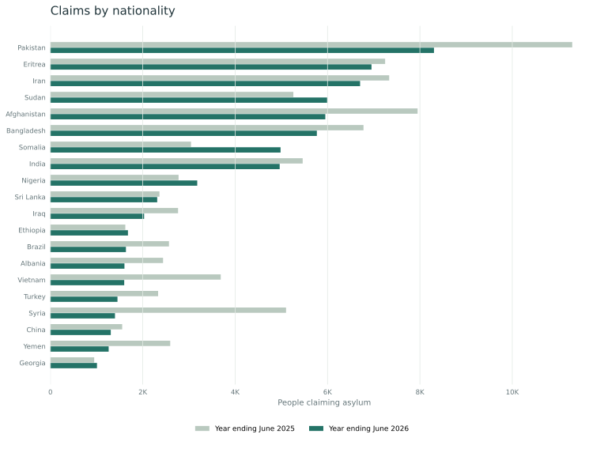{fig-alt="Paired horizontal bars compare asylum claims for the 20 individually listed nationalities in the two years ending June 2025 and June 2026; Pakistan is the largest group in the latest year."}

The age chart shows calendar-year totals by the four published age bands. UASC are plotted as a separate line **within the child population**, not as an additional group to add to the stacked bars. The Home Office recorded **4,275 UASC claims** in the year ending June 2026; age-band totals can differ from the published total by up to seven people in this edition, reflecting small differences in the source breakdown.

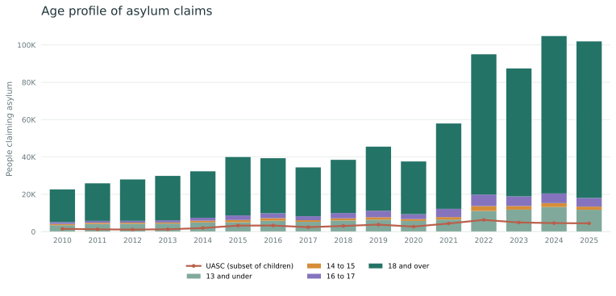{fig-alt="Stacked bars show asylum claims by four age bands from 2010 to 2025, with a separate line for UASC as a subset of children."}

Table `Asy_01c` classifies claims by route before the asylum claim, including small boats, clandestine entry, entry without relevant documentation, and visas or other leave. The route series begins in 2018. The Home Office labels this table **Official Statistics in Development**; figures, particularly for 2018 and 2019, are rounded and may be revised. Prior route describes the recorded route before claiming, not a finding about the merits of an asylum claim.

The 2018–2025 chart uses the component categories rather than the “Illegal Entry Routes” subtotal, avoiding double-counting. In the year ending June 2026, the table recorded **33,949 claims by small boat** and **34,999 following visas or other leave**.

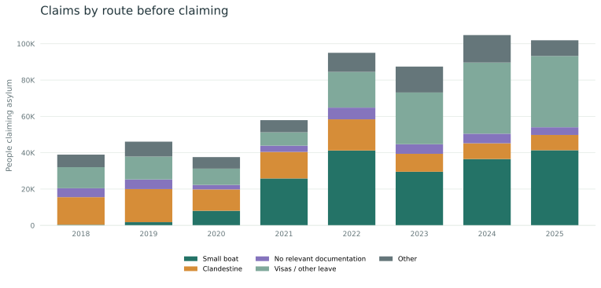{fig-alt="Stacked bars show claims by small boat, clandestine entry, entry without relevant documentation, visas or other leave, and other routes from 2018 to 2025."}

Table `Asy_01d` cross-tabulates nationality with prior route for the year ending June 2026. Its categories are useful for describing the published totals, but should not be read as a measure of individual journeys or outcomes.

The nationality-route chart shows the 12 largest individually listed nationalities and the all-nationalities total as shares of each group’s claims. Of **6,952 Eritrean claims**, 6,125 were recorded under small boat; for Pakistan, 7,324 of 8,305 claims were under visas and other leave. These are aggregate categories, not descriptions of every person’s journey.

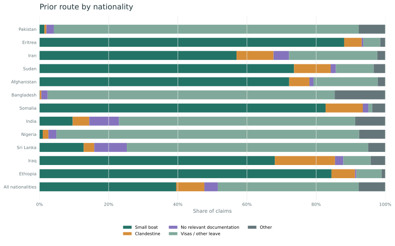{fig-alt="100 percent stacked bars compare the recorded route mix for 12 nationalities and all nationalities in the year ending June 2026."}

## Decisions and outcomes

The initial-decision count is an event flow; a decision in one year may concern a claim made earlier. Tables `Asy_02a` and `Asy_02b` show grant types and decisions involving children and UASC. The outcome categories include protection, other leave, refusal and, in the supplementary tables, withdrawal and administrative outcomes. These definitions are not interchangeable with “grant” alone.

::: {.callout-note}
### How the grant rate is calculated

The Home Office defines the initial grant rate for **main applicants** as the share of substantive initial decisions that resulted in a grant of protection or other leave. The denominator is grants plus refusals—not all applications or all recorded outcomes—and excludes withdrawals and administrative outcomes. The Home Office records **16,265 withdrawals** separately in `Asy_00a` for the year ending June 2026; they are not added to this denominator. [See the Home Office definition](https://www.gov.uk/government/statistics/immigration-system-statistics-year-ending-june-2026/how-many-people-are-granted-asylum-in-the-uk).

This is distinct from the UNHCR all-decision outcome shares in [Asylum Tracker](https://aloysius109.github.io/asylum-tracker/asylum/grants.html), where “otherwise closed” outcomes are included in the denominator. Asylum Tracker’s separate refugee-recognition and total-protection rates use substantive decisions and exclude closures; its total-protection rate is the closer comparison to the Home Office numerator, though the sources and units differ. The published small-boat rates in `Asy_02d` and cohort rates in `Asy_04` also exclude withdrawals and administrative outcomes, but use cases and claim cohorts respectively rather than the main-applicant population.
:::

The main published initial grant rate shown above is for main applicants. Table `Asy_00a` also reports people receiving decisions, while the small-boat nationality rates in `Asy_02d` use **cases**. The table’s case-based rates should not be compared directly with people-based counts or described as a main-applicant rate.

The detailed outcome table `Asy_02c` compares cases and people in the years ending June 2025 and June 2026. Its total includes multiple types of outcomes, not only grants and refusals. The downloadable workbook-derived tables retain the source’s own units and categories.

The quarterly chart compares people claiming asylum with the recorded outcome groups in the quarterly decision data. A claim and an outcome in the same quarter do not necessarily concern the same people: decisions may follow claims made earlier. Withdrawals and administrative outcomes are shown for completeness, but the grant-rate denominator remains grants plus refusals for substantive decisions.

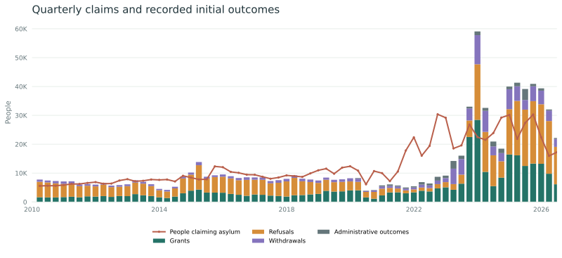{fig-alt="Quarterly bars stack grants, refusals, withdrawals and administrative outcomes; a line shows asylum claims. Claims and outcomes are separate period flows, not linked cohorts."}

### Face-value productivity

We estimate **face-value productivity (FVP)** as recorded initial outcomes divided by claims received in the same period, expressed as outcomes per 100 claims. Following the broad all-decision approach used in the UNHCR report, the numerator includes grants, refusals, withdrawals and administrative outcomes—not just substantive decisions. A value of 100 means the number of outcome events matches the number of claims recorded in that period; below 100, fewer outcomes than claims were recorded, and above 100, more. This is a comparison of flows, not a measure of how quickly a particular claim was decided.

The annual series fell to **32.7 outcomes per 100 claims in 2022**, then rose to **139.9 in 2023** and **157.7 in 2025**. The rolling year ending June 2026 recorded **134,484 outcomes against 85,891 claims**, or **156.6 per 100**. The three-year centred mean helps show the longer trend; the dashed substantive-only line is shown for context and is not the Home Office grant rate, whose denominator remains grants plus refusals.

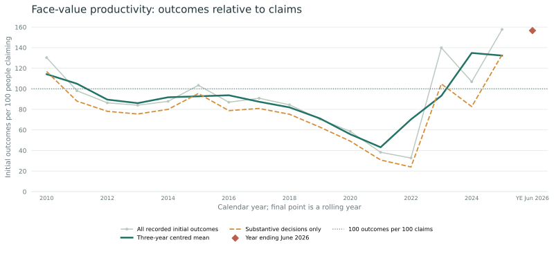{fig-alt="Lines show all recorded initial outcomes per 100 claims, a three-year centred mean, and substantive decisions only for calendar years 2010–2025; a separate diamond marks the rolling year ending June 2026. The dotted horizontal line marks 100 outcomes per 100 claims."}

The second chart shows the difference in counts directly. In 2022 outcomes were **63,933 below claims**; in 2025 they were **58,819 above claims**. Across 2010–2025 the cumulative difference was **−46,892**. This cumulative balance is not an estimate of the current backlog: decisions in a year can relate to older claims, and the series does not account for every source of change to the stock. In particular, 2010 decisions may include legacy claims from before this series begins.

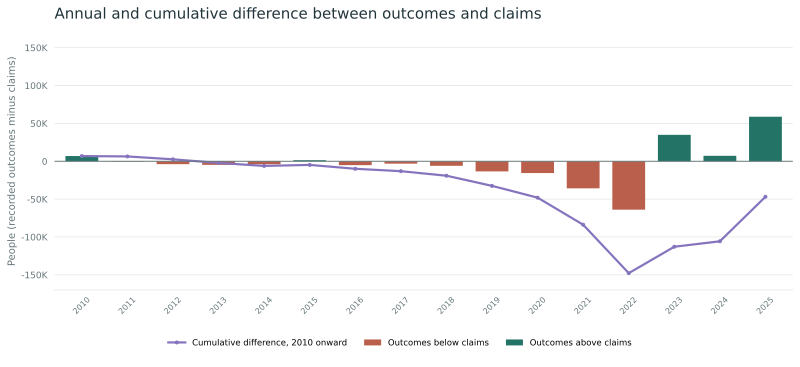{fig-alt="Diverging bars show annual differences between recorded initial outcomes and claims received, while a line shows the cumulative difference since 2010. Negative bars indicate fewer outcomes than claims; positive bars indicate more."}

These are people-based administrative flows, not linked claim cohorts, staff productivity or waiting-time measures. Administrative outcomes are recorded in the quarterly extract only from 2020, so earlier all-outcome totals have less complete coverage. Asylum Tracker’s separate **2025 UK FVP estimate of 116** uses UNHCR reporting data and a broader reporting basis; it is not directly comparable with this Home Office series. [Download the annual FVP series and flow gaps](data/derived/face-value-productivity.csv).

Table `Asy_02a` separates the types of asylum-related grants. In the year ending June 2026 it records **42,394 asylum-related grants** and **3,840 resettlement arrivals**. Resettlement arrivals are plotted separately because they are not initial decisions; source blanks for temporary refugee permission are shown as zero only to render the chart, while remaining missing in the parsed data.

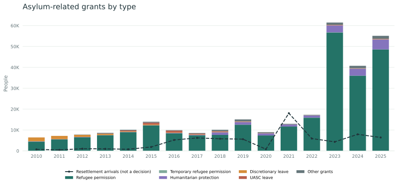{fig-alt="Stacked bars show six types of asylum-related grants from 2010 to 2025; a dashed line shows resettlement arrivals separately."}

In 2024, the published total is one higher than the sum of the grant components and resettlement arrivals; the chart retains the published component values rather than adjusting them.

## Small-boat claims and outcomes

The Home Office recorded **33,949 small-boat asylum claims** in the year ending June 2026, down from 42,389 in the year ending June 2025. These are claims by route, not a count of all small-boat arrivals; a person arriving by small boat may claim later, and not every arrival is represented as a claim in the same period.

The published small-boat nationality table compares initial-decision volumes and grant rates for cases. The overall case-based grant rate was **55.7%** in the year ending June 2025 and **47.7%** in the year ending June 2026.

{fig-alt="Horizontal paired bars compare published case-based small-boat grant rates by nationality in the years ending June 2025 and 2026."}

Rates by nationality describe recorded initial decisions for cases in the stated periods. They do not predict the outcome of an individual case, and the total rate can change with the mix of nationalities and decisions.

## Inadmissibility

Table `Asy_02e` reports people identified for consideration under inadmissibility rules, notices of intent, inadmissibility decisions, removals and people subsequently admitted to the UK asylum process. A notice of intent is not itself a final inadmissibility decision, and inadmissibility is not a refusal of the asylum claim on its merits.

:::: {.metric-row .inadmissibility}
:::: {.metric-card}
105,828
Subsequent-admission events
97.6% of identification events in the period; not a linked-person rate
::::

:::: {.metric-card}
108,455
Identification events
2021 Q1–2026 Q2
::::

:::: {.metric-card}
1,133
Enforced removal events
1.0% of identification events; voluntary returns excluded
::::
::::

**The headline is the contrast:** the Home Office recorded nearly as many subsequent-admission events as identification events, but very few removals in the same period. These are aggregate event counts, not outcomes linked to the same people; the table cannot tell us what happened to each person identified or why they were later admitted.

:::: {.callout-note}
### What does “inadmissibility” mean, and when did it begin?

An asylum claim may be declared inadmissible when the claimant has a legally defined connection to a **safe third country**—for example, protection there, a claim for protection there, or a reasonable opportunity to seek it. The UK then does not substantively consider the claim at that stage. This is not a finding that the claim is unfounded or that the person can in practice be removed. The main framework is in sections 80B–80C of the [Nationality, Immigration and Asylum Act 2002](https://www.legislation.gov.uk/ukpga/2002/41/part/4A); separate section 80A rules apply to EU nationals.

The post-Brexit rules began on **1 January 2021**, in [Immigration Rules paragraphs 345A–345D](https://www.gov.uk/government/publications/statement-of-changes-to-the-immigration-rules-hc-1043-10-december-2020/statement-of-changes-to-the-immigration-rules-hc-1043-10-december-2020-accessible-version), as the UK left the EU’s Dublin asylum-transfer arrangements. The [Nationality and Borders Act 2022](https://www.legislation.gov.uk/ukpga/2022/36/section/17) later put the main safe-third-country framework into primary legislation for claims from **28 June 2022**.
::::

:::: {.callout-note}
### Why are so many later admitted to the UK asylum process?

Inadmissibility only avoids a UK decision on the asylum claim if removal to a safe third country can actually happen. The rule is explicit: under [paragraph 345D](https://www.gov.uk/guidance/immigration-rules/immigration-rules-part-11-asylum), when removal within a reasonable period is unlikely, the claim **must be admitted for consideration in the UK**. A transfer also depends on a safe country being willing and able to receive the person; the `Asy_02e` table does not record the reason for any individual admission.

The UK’s broad Dublin transfer system ended when the Brexit transition period ended, and replacement arrangements have been limited. The Home Office discontinued its Rwanda removal policy in July 2024. The UK–France agreement, operational from **6 August 2025**, created a specific return route for some people arriving by small boat; a separate Home Office release records **1,087 returns to France** under that agreement between 6 August 2025 and 30 June 2026. Before that agreement, the Home Office table recorded only **38 removal events from January 2021 through June 2025**. The France figure comes from a different publication and is not a person-level reconciliation with `Asy_02e`.

So the rules and limited practical transfer routes help explain the large gap between admission and removal events. They do **not** prove why any particular person was admitted, and the aggregate figures should not be read as a cohort conversion rate.
::::

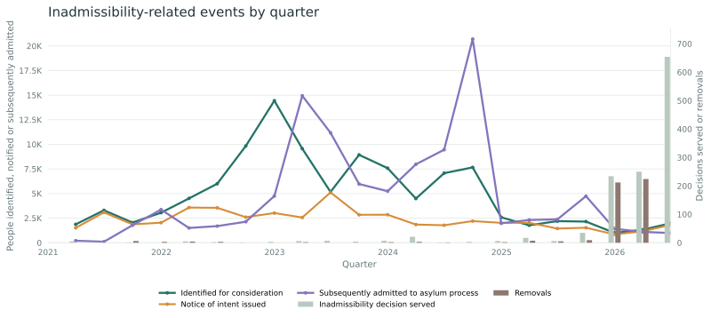{fig-alt="Quarterly lines show people identified for inadmissibility consideration, notices of intent and later admissions to the asylum process. Bars use a separate right-hand scale for inadmissibility decisions served and removals."}

The second chart compares totals for the same period. It makes the small number of removals visible alongside the much larger identification and admission event counts; the exact values are labelled on the bars.

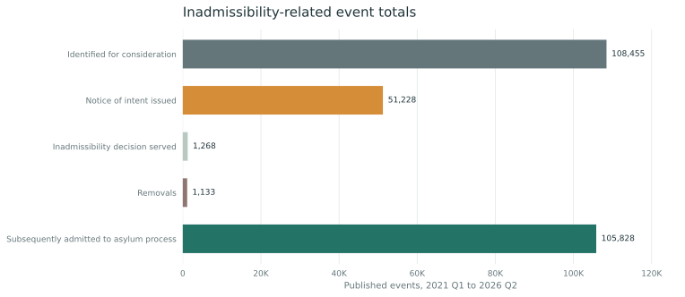{fig-alt="Horizontal bars compare published event totals: 108,455 identified, 51,228 notices of intent, 1,268 inadmissibility decisions served, 1,133 removals and 105,828 subsequently admitted."}

The quarterly figures are management information; the latest seven quarters are provisional (Notes 30–35). The categories record administrative events, not a linked sequence for the same people, and should not be read as a conversion funnel. The table reports enforced removals, not voluntary returns. Decision-served and removal events rise sharply from 2025 Q4, but the table does not identify when those people were first considered. The removal series in this edition includes returns to France under the UK–France agreement, following the August 2026 release. [Download the quarterly series and cumulative totals](data/derived/inadmissibility.csv).

## Backlog and waiting times

The June 2026 headline counts **40,168 people** and **32,401 cases** awaiting an initial decision. Table `Asy_03a` groups the waiting stock by elapsed time, from less than three months to 12 months or more. The published waiting durations cover **only the wait for an initial decision**; they do not measure the full time until an asylum case is resolved.

The wider WIP snapshot shows why that distinction matters. In June 2024, **137,525 main-applicant cases** were classified as “Post Decision”, compared with **87,217** awaiting an initial decision. The post-decision group was larger, so the total time people spend in the asylum system is likely to be longer than the initial-decision waits shown here. These WIP figures are cases, whereas `Asy_03a` durations count people; the WIP series is suspended after June 2024 and does not publish durations for post-decision cases, so the report cannot quantify end-to-end waiting time.

{fig-alt="A stacked bar divides people awaiting an initial decision into four published waiting-time categories; these are not total asylum-process durations."}

The wider work-in-progress (WIP) queue was **224,742 main-applicant cases** in June 2024, the latest published snapshot. The table classifies **87,217 (38.8%)** as awaiting an initial decision and **137,525 (61.2%)** as “Post Decision”. That is a useful indication of how many cases had moved beyond the initial-decision stage, not a count of cases whose asylum process was complete. The Home Office has suspended this WIP series after June 2024 (Note 26), so this is not a current 2026 total.

The chart compares three published indicators: quarterly applications awaiting an initial decision (`ASY_02`), the tribunal’s open asylum/protection and revocation caseload (`FIA_4`), and the broader ASY_03 WIP totals available only for June snapshots through 2024. They have different coverage and are not additive; the tribunal series is not linked to the Home Office cases.

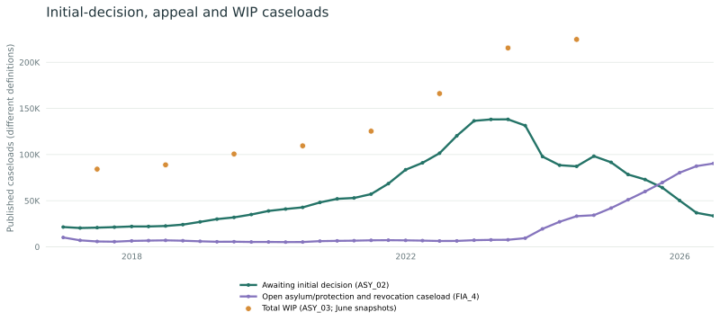{fig-alt="Three separate indicators: Home Office applications awaiting an initial decision fell to 33,514 by June 2026; tribunal asylum/protection and revocation caseload rose to 90,341; the broader total WIP is shown only at June snapshots through 2024, ending at 224,742. The measures have different coverage and cannot be added."}

The Home Office’s `ASY_02` count is **33,514 applications** in June 2026, compared with **87,217** in June 2024. This is a 61.6% fall within that series. The separate `D03` release reports **32,401 main-applicant cases** at June 2026; the small difference between publications is another reason to keep their series distinct. [Download the quarterly queue indicators](data/derived/queue-indicators.csv).

The two headline counts with similar wording are from different dates and use different units. The pending-decision table (`Data_Asy_D03`) counts people, including dependants; ASY_03 reports main-applicant cases in the wider WIP queue.

| Source and measure | Unit | June 2024 | June 2026 |
|:--|:--|--:|--:|
| D03: awaiting an initial decision, all applicants | People | 118,882 | 40,168 |
| D03: awaiting an initial decision, main applicants | Main-applicant cases | 85,839 | 32,401 |
| ASY_03 WIP: awaiting an initial decision | Main-applicant cases | 87,217 | Not published |

For June 2026, the **40,168 people** comprise **32,401 main applicants and 7,767 dependants**. At the same date in June 2024, D03 counted **118,882 people**, including **85,839 main applicants and 33,043 dependants**. So the apparent 40,168-versus-87,217 gap is mostly explained by comparing different dates and people with cases. On a like-for-like June 2024 basis, the main-applicant figures are close: **85,839 in D03 and 87,217 in ASY_03, a difference of 1,378 cases**. These are separately compiled publications; the report does not assume that their definitions or coverage are identical.

The stage chart shows the reported split over time. Percentages above the bars are the shares not awaiting an initial decision. “On Hold” includes people who may be either before or after a decision, so from 2014 to 2023 the number definitely beyond the initial-decision stage is at least the sum of the other post-decision categories, while the not-awaiting figure is an upper bound. The 2024 “Post Decision” segment has no further breakdown. A methodology change in April 2014 also means earlier totals are not directly comparable.

Do not subtract the **40,168 people** in June 2026 from the **224,742 WIP cases** in June 2024 to estimate how many cases remain after an initial decision. The WIP table already reports its own stage split for June 2024; the later pending count is a separate snapshot, and the two publications are not interchangeable.

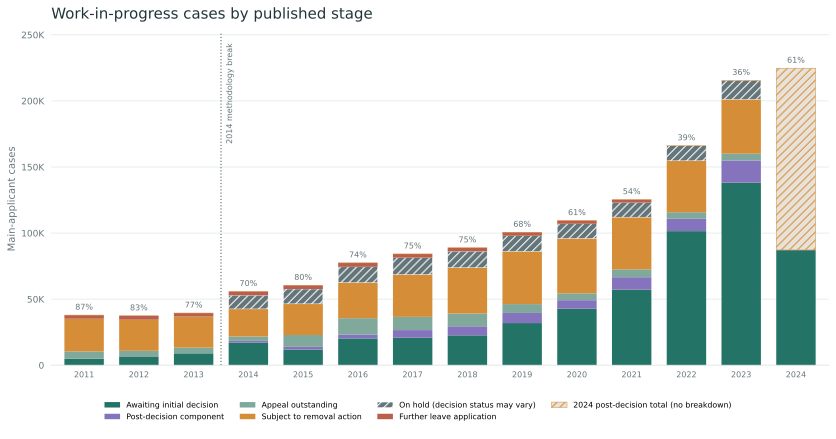{fig-alt="Stacked columns show main-applicant work-in-progress cases by published stage from 2011 to 2024. The hatched 2024 segment is an aggregate post-decision count without a category breakdown, and hatched On Hold cases may be before or after a decision. Labels above bars show the percentage not awaiting an initial decision; a vertical marker identifies the 2014 methodology break."}

Tables `Asy_03b` and `Asy_03c` separate pre-Nationality and Borders Act (pre-NABA) backlog claims, post-NABA backlog claims and the “flow” group of claims made on or after 28 June 2022. They show claims lodged, decisions and remaining initial-decision claims across quarterly dates. The groups have different histories and definitions; the tables should not be collapsed into a single, comparable cohort. The Home Office says these tables will be discontinued after this release, so a future edition may need a different source series.

## What happens to each year’s claims?

Table `Asy_04` follows claim-year cohorts and reports decisions, grants, refusals, returns and the latest known outcome. A claim cohort is different from the annual flow of decisions: some claims are decided after the year in which they were made.

Recent cohorts are incomplete. In the 2025 cohort, 9,009 claims still had a latest outcome not yet known in this release. The table’s estimated grant rates are calculated for the cohort and should not be read as the final result for unresolved cases or as a prediction of later cohorts.

## Children and age assessments

`Asy_01a` reports claimants by age and the number of unaccompanied asylum-seeking children. `Asy_02b` reports initial decisions, grants and refusals for children and UASC. Those are different event populations: a child who claimed in a year may receive an initial decision in a later year.

For the year ending June 2026, the Home Office recorded **17,529 initial decisions involving children**, of which 6,518 resulted in grants and 11,011 in refusals. **4,051 UASC** received initial decisions; 2,329 were granted and 1,722 refused. The UASC rate was **57.5%**. The first chart shows UASC decisions as a subset of the child total; the second compares the substantive UASC rate with the main-applicant rate, which refers to a different population.

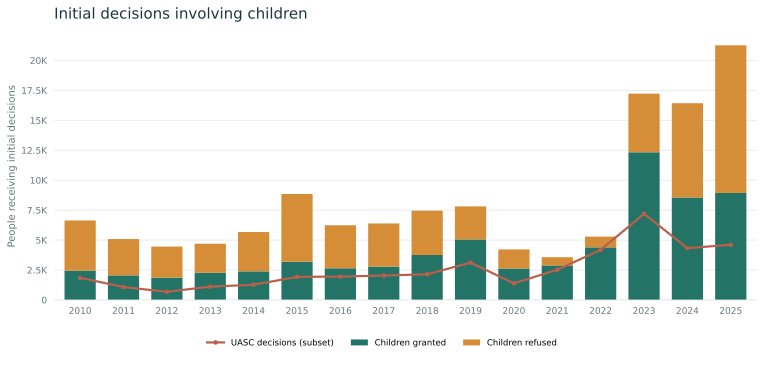{fig-alt="Stacked bars show child initial decisions resulting in grants or refusals from 2010 to 2025; a line shows UASC decisions as a subset."}

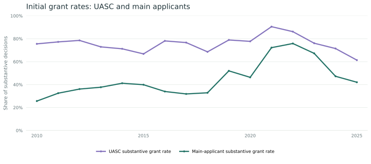{fig-alt="Two lines compare the grant share of substantive initial decisions for UASC and main applicants from 2010 to 2025; the populations differ."}

Table `Asy_05` records age assessments, including the number raised and closed and the recorded assessment result. These are administrative statistics about referrals and completed assessments; they do not describe all children claiming asylum and should not be treated as an independent estimate of a person’s age.

In the year ending June 2026, **6,409 assessments were raised** and **6,265 were closed**. Of the closed assessments, 3,512 recorded an assessment of 17 and under, and 2,753 recorded 18 and over. The chart keeps assessments raised separate from closures: the two counts in a period are not necessarily the same cases, and the age category is the assessment’s finding.

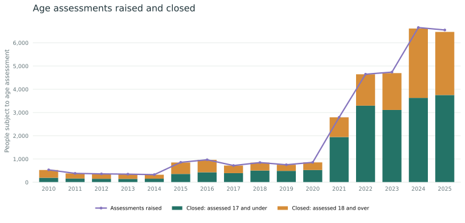{fig-alt="Stacked bars divide closed age assessments into results of 17 and under or 18 and over; a separate line shows assessments raised."}

The results describe administrative assessments, not an independent estimate of the ages of all people claiming asylum. `UASC` continues to mean **Unaccompanied Asylum-Seeking Child** in this section.

## Asylum support and accommodation

At the end of June 2026, **93,293 asylum seekers** were recorded as receiving support and **16,021** were accommodated in hotels. Table `Asy_09a` gives support by section, and `Asy_09b` provides a breakdown by family or applicant group. The annual support chart uses the totals in `Asy_09b` where available.

{fig-alt="A line chart shows Home Office counts of people receiving asylum support at December and June observations."}

Support counts are not counts of households or hotel rooms. The hotel figure is a subset of people receiving support, not an additional population to add to that total.

The quarterly accommodation dataset shows that hotel accommodation peaked at **56,018 people in September 2023** and fell to **16,021 in June 2026**. The Home Office records hotels separately from the quarter ending December 2022; this series cannot show hotel use before then.

{fig-alt="A quarterly chart shows all people receiving support, the Section 98 accommodation category through September 2022, and the separately reported hotel series from December 2022. The hotel series peaks in September 2023 and falls to June 2026."}

The Section 98 line is a separate historical category, **not a hotel count**. Home Office notes say that before 30 June 2023 the Section 98 figures include people in initial or contingency accommodation regardless of support eligibility. The accommodation dataset also classifies Section 4 recipients as dispersal before 31 March 2023, even where hotels were used. The chart counts people, not rooms; the source’s “Unknown” region is retained in the regional totals.

The regional breakdown compares the September 2023 national hotel peak with June 2026. London had the largest regional count in June 2026, with **5,487 people** accommodated in hotels.

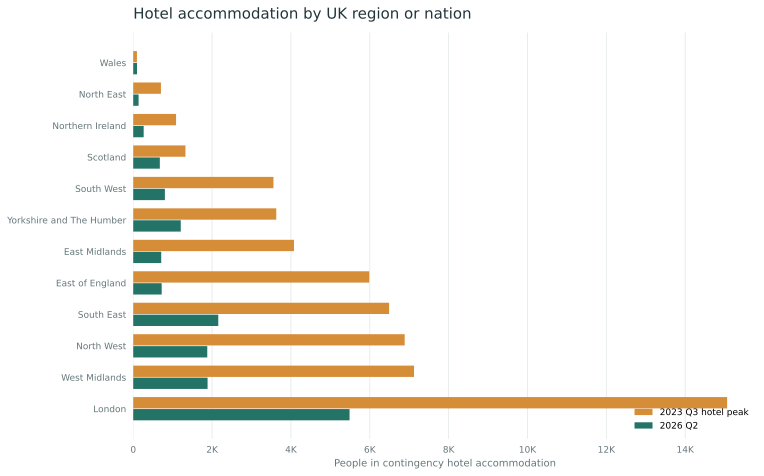{fig-alt="Paired horizontal bars compare hotel accommodation by UK region or nation at the September 2023 peak and in June 2026, including the Unknown category."}

## Returns

The summary table reports returns by year, but the Home Office’s detailed return workbook and claims datasets support a quarterly comparison. The first chart shows people claiming asylum, substantive initial decisions (grants plus refusals), and asylum-related returns. **Monthly counts are not published in these tables**, so quarterly is the finest common period. In the latest quarter, 2026 Q2, the sources record 17,233 claims, 19,079 substantive initial decisions and 3,157 asylum-related returns. The latest seven quarters are provisional and may be revised.

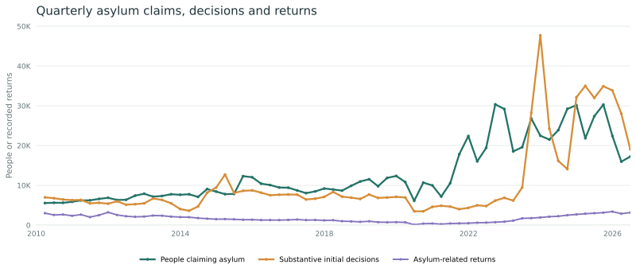{fig-alt="Three quarterly lines compare people claiming asylum, substantive initial decisions, and asylum-related returns from 2010 Q1 through 2026 Q2. Returns are much lower in volume than claims and decisions."}

The quarterly return measure combines enforced and voluntary asylum-related returns and **excludes** people refused entry at port who subsequently departed. Returns are recorded events, not a count of initial refusals; they may relate to claims or decisions from earlier periods. The quarterly decision line uses the same substantive denominator described above and excludes withdrawals and administrative outcomes.

The second chart compares the quarterly stock of people awaiting an initial decision with returns over the previous four quarters. In the year ending June 2026, there were **12,568 asylum-related returns**: 3,841 enforced and 8,727 voluntary. The chart also shows the Home Office’s wider total work-in-progress series, which counts **main-applicant cases** and is published annually through June 2024. At June 2026, 40,168 people were awaiting an initial decision; the latest June work-in-progress total was 224,742 cases in 2024.

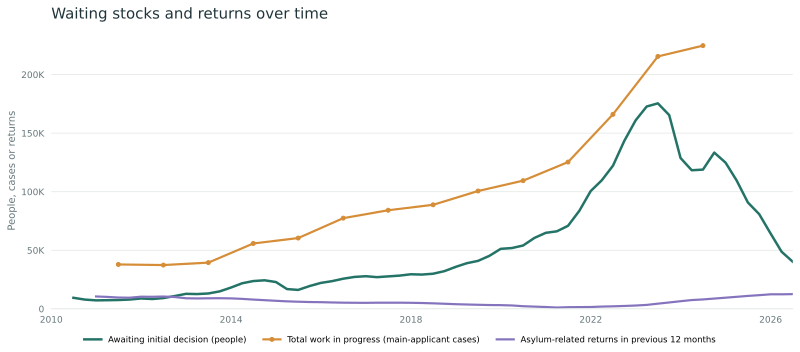{fig-alt="A common-scale chart compares people awaiting an initial decision, the broader annual work-in-progress case count through June 2024, and asylum-related returns in the previous 12 months."}

The lines use a common count scale to show their different magnitudes, but their units and coverage differ: the pending series counts people, work in progress counts main-applicant cases, and returns are events. These administrative measures are **not a complete estimate of every asylum seeker currently in the UK**; the published tables do not provide one comprehensive population-stock series. The flows and stocks are not linked cohorts, so returns should not be subtracted from either stock to estimate its change. `Asy_04` separately reports known returns for claim-year cohorts and uses a different basis.

## Data, definitions and reproducibility

This edition uses the Home Office **asylum summary tables, year ending June 2026**, published on 27 August 2026, alongside reviewed quarterly extracts from the asylum claims, pending, returns, migration-transparency and asylum-support workbooks and the Ministry of Justice’s [**Tribunal Statistics Quarterly, April to June 2026**](https://www.gov.uk/government/statistics/tribunals-statistics-quarterly-april-to-june-2026) main tables. The inadmissibility explanation follows the Home Office’s [safe-third-country caseworker guidance](https://www.gov.uk/government/publications/inadmissibility-third-country-cases) and [Immigration Rules, Part 11](https://www.gov.uk/guidance/immigration-rules/immigration-rules-part-11-asylum); the transfer-history context is cross-checked against the [House of Commons Library briefing](https://commonslibrary.parliament.uk/research-briefings/cbp-9724/) and Home Office publications on the [Rwanda policy](https://www.gov.uk/government/publications/asylum-claims-under-the-migration-and-economic-development-partnership) and [UK–France returns](https://www.gov.uk/government/publications/the-border-security-commanders-annual-report-data/transfers-into-and-returns-from-the-united-kingdom-under-the-uk-france-agreement-on-the-prevention-of-dangerous-journeys-between-6-august-2025-and-30). The summary ODS fingerprint is recorded in `data/raw/source.json`; quarterly workbook and extract hashes are recorded in `data/raw/quarterly-sources.json`. The analysis refuses to run if the ODS or any committed quarterly extract differs from its pinned hash. Rendering the report does not download or silently replace source data.

The analysis parses 18 summary tables directly and validates the quarterly flow extracts against `Asy_00a` for calendar years 2010–2025, the year ending June 2026 and the latest pending stock. D03 main-applicant pending counts reconcile to the `Asy_00a` case total in June 2026; the June 2024 D03 and ASY_03 figures are shown side by side but remain separate source measures. `Asy_02e` quarterly event values reconcile to its published totals; its admission/removal comparisons are not person-level outcomes. The `ASY_02` initial-decision waiting bands sum to the published total and match `ASY_03` awaiting counts at June snapshots from 2017 through 2024. MoJ `FIA_4` financial-year quarters are mapped to calendar quarters; its tribunal caseload is shown as a separate indicator, not added to Home Office WIP. Support and hotel counts are reconciled for year-end 2022–2025 and June 2026; regional hotel counts also sum to the national totals. ASY_03 stage counts reconcile to the total WIP count; June 2024 has only the awaiting and aggregate post-decision split, and “On Hold” is excluded from the lower-bound count of cases beyond an initial decision. The ASY_03 work-in-progress series ends in June 2024. Cells marked `z`, `:`, `-`, or similar source suppression or non-applicability markers remain missing; they are never converted into zero. Calendar years, rolling years and quarters remain distinct. The 2011 claim total in `Asy_00a` differs by six from `Asy_01a`; the tables retain the source figures and are not forcibly reconciled across tables.

The FVP series divides grants, refusals, withdrawals and administrative outcomes by claims in the same period, and reports outcomes per 100 claims. Its three-year mean is centred on each calendar year; the June 2026 point is a separate rolling-year ratio. The cumulative outcomes-minus-claims line covers calendar years 2010–2025 and is not a backlog estimate.

Count axes use comma-separated values below 10,000 and `K` abbreviations at or above that scale; this convention is implemented in `COUNT_AXIS_K_THRESHOLD` in `scripts/analyze.py`. Chart legends sit below the plot area rather than over the data, with clear space beneath the axis labels.

In the grant-type chart, missing source values for temporary refugee permission are represented as zero only for plotting; the parsed source data preserve them as missing. Resettlement arrivals are shown separately from initial decisions.

The workbook also contains appeals data, but its series ends in March 2023 because later data were unavailable. This report does not present an appeals chapter. Prior-route figures are Official Statistics in Development. Tables `Asy_03b` and `Asy_03c` are scheduled to be discontinued after this release.

To rebuild locally, install the packages in `requirements.txt`, run `python scripts/prepare_quarterly.py` when reconstructing the pinned extracts, then run `python scripts/analyze.py`, `python scripts/check_report.py`, and `quarto render`. Run `python -m pytest tests` for parser and consistency checks. The output is a fixed, reviewable snapshot, not an automatic refresh of the Home Office data.

## Download the data

These files are derived from the pinned workbook above. The all-table CSV is a long-form export; it preserves the source table, row label, column heading, and value so units and reporting periods remain visible.

::: {.download-list}
- [Annual summary, 2010–2025 (CSV)](data/derived/annual-summary.csv)
- [Year ending June 2026 headline values (CSV)](data/derived/year-ending-june-2026.csv)
- [All parsed table values (CSV)](data/derived/all-table-values.csv)
- [Parsed tables with provenance (JSON)](data/derived/tables.json)
- [Home Office asylum summary workbook (ODS)](data/raw/asylum-summary-jun-2026.ods)
- [Source URL, retrieval time and SHA-256 (JSON)](data/raw/source.json)
- [Quarterly claims, decisions, returns and pending stock (CSV)](data/derived/quarterly-flows.csv)
- [Annual face-value productivity ratios and decisions-minus-claims gaps (CSV)](data/derived/face-value-productivity.csv)
- [ASY_03 work-in-progress snapshots (CSV)](data/raw/asylum-work-in-progress.csv)
- [ASY_03 work-in-progress stages and calculated shares (CSV)](data/derived/work-in-progress-stages.csv)
- [Quarterly initial-decision, tribunal and WIP queue indicators (CSV)](data/derived/queue-indicators.csv)
- [Quarterly inadmissibility events and cumulative totals (CSV)](data/derived/inadmissibility.csv)
- [Quarterly support and accommodation series (CSV)](data/derived/quarterly-support-accommodation.csv)
- [Hotel accommodation by region or nation (CSV)](data/derived/hotel-by-region.csv)
- [Pinned quarterly support/accommodation extract (CSV)](data/raw/support-accommodation-extract.csv)
- [Quarterly source URLs and fingerprints (JSON)](data/raw/quarterly-sources.json)
:::

## Related reports

- [Asylum Tracker](https://aloysius109.github.io/asylum-tracker/asylum/) — the separate report combines global UNHCR analysis with a short UK comparison. This report focuses on the wider set of Home Office UK tables.