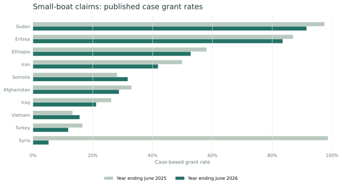
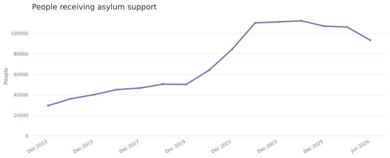

United Kingdom | Home Office statistics | June 2026 edition

The Home Office recorded **101,911 people claiming asylum in calendar year 2025**. The latest rolling-year figures in this edition cover the year ending June 2026: 85,891 people claimed asylum, 115,872 received an initial decision, and 40,168 people were waiting for an initial decision at the end of June.

::: {.metric-row}
::: {.metric-card}
101,911
People claiming asylum in calendar 2025
Calendar-year flow; people, not cases
:::

::: {.metric-card}
38.1%
Published initial grant rate
Year ending June 2026; main applicants
:::

::: {.metric-card}
40,168
People awaiting an initial decision
At the end of June 2026
:::
:::

## The overall picture

Calendar-year flows and rolling years answer different questions. The 2025 calendar-year series is shown through 2025; the year ending June 2026 is reported separately, not treated as a calendar 2026 value. In that latest rolling year, 85,891 people claimed asylum and 115,872 received an initial decision. Those decisions comprised 42,394 grants of protection or other leave and 73,478 refusals.

{fig-alt="Two lines show annual asylum claims and initial decisions from 2010 to 2025, with a large rise in recent years and fewer claims in 2025."}

The Home Office reports its initial grant rate directly. It was **42.1% in calendar 2025** and **38.1% in the year ending June 2026**. The published rate applies to **main applicants** and includes protection or other leave; it is not recalculated here from counts that include dependants.

{fig-alt="A line chart shows the Home Office published main-applicant initial grant rate from 2010 to 2025."}

The latest pending headline is **40,168 people**, or **32,401 cases**, awaiting an initial decision. They are different units and must not be added together. This stock is not a measure of all people involved in every stage of the asylum process.

## Who claims asylum?

Tables `Asy_01a` and `Asy_01b` break claims down by age, unaccompanied asylum-seeking children (UASC), and nationality. The age and UASC series cover calendar years and also provide a separate year-ending-June comparison. The nationality table shows the larger origin groups and an “Other” category; it is not a complete list of every nationality in the detailed source data.

Table `Asy_01c` classifies claims by route before the asylum claim, including small boats, clandestine entry, entry without relevant documentation, and visas or other leave. The route series begins in 2018. The Home Office labels this table **Official Statistics in Development**; figures, particularly for 2018 and 2019, are rounded and may be revised. Prior route describes the recorded route before claiming, not a finding about the merits of an asylum claim.

Table `Asy_01d` cross-tabulates nationality with prior route for the year ending June 2026. Its categories are useful for describing the published totals, but should not be read as a measure of individual journeys or outcomes.

## Decisions and outcomes

The initial-decision count is an event flow; a decision in one year may concern a claim made earlier. Tables `Asy_02a` and `Asy_02b` show grant types and decisions involving children and UASC. The outcome categories include protection, other leave, refusal and, in the supplementary tables, withdrawal and administrative outcomes. These definitions are not interchangeable with “grant” alone.

::: {.callout-note}
### How the grant rate is calculated

The Home Office defines the initial grant rate for **main applicants** as the share of substantive initial decisions that resulted in a grant of protection or other leave. The denominator is grants plus refusals—not all applications or all recorded outcomes—and excludes withdrawals and administrative outcomes. The Home Office records **16,265 withdrawals** separately in `Asy_00a` for the year ending June 2026; they are not added to this denominator. [See the Home Office definition](https://www.gov.uk/government/statistics/immigration-system-statistics-year-ending-june-2026/how-many-people-are-granted-asylum-in-the-uk).

This is distinct from the UNHCR all-decision outcome shares in [Asylum Tracker](https://aloysius109.github.io/asylum-tracker/asylum/grants.html), where “otherwise closed” outcomes are included in the denominator. Asylum Tracker’s separate refugee-recognition and total-protection rates use substantive decisions and exclude closures; its total-protection rate is the closer comparison to the Home Office numerator, though the sources and units differ. The published small-boat rates in `Asy_02d` and cohort rates in `Asy_04` also exclude withdrawals and administrative outcomes, but use cases and claim cohorts respectively rather than the main-applicant population.
:::

The main published initial grant rate shown above is for main applicants. Table `Asy_00a` also reports people receiving decisions, while the small-boat nationality rates in `Asy_02d` use **cases**. The table’s case-based rates should not be compared directly with people-based counts or described as a main-applicant rate.

The detailed outcome table `Asy_02c` compares cases and people in the years ending June 2025 and June 2026. Its total includes multiple types of outcomes, not only grants and refusals. The downloadable workbook-derived tables retain the source’s own units and categories.

## Small-boat claims and outcomes

The Home Office recorded **33,949 small-boat asylum claims** in the year ending June 2026, down from 42,389 in the year ending June 2025. These are claims by route, not a count of all small-boat arrivals; a person arriving by small boat may claim later, and not every arrival is represented as a claim in the same period.

The published small-boat nationality table compares initial-decision volumes and grant rates for cases. The overall case-based grant rate was **55.7%** in the year ending June 2025 and **47.7%** in the year ending June 2026.

{fig-alt="Horizontal paired bars compare published case-based small-boat grant rates by nationality in the years ending June 2025 and 2026."}

Rates by nationality describe recorded initial decisions for cases in the stated periods. They do not predict the outcome of an individual case, and the total rate can change with the mix of nationalities and decisions.

## Inadmissibility

Table `Asy_02e` reports people identified for consideration under inadmissibility rules, notices of intent, inadmissibility decisions, removals and people subsequently admitted to the UK asylum process. It is a sequence of administrative stages, not a count of people refused protection on the merits. A notice of intent is not itself a final inadmissibility decision, and later admission to the asylum process is represented separately.

The table is quarterly, beginning in 2021. Its removal figures were updated in the August 2026 release to include returns to France under the UK–France agreement, so earlier releases may not match this snapshot.

## Backlog and waiting times

The June 2026 headline counts **40,168 people** and **32,401 cases** awaiting an initial decision. Table `Asy_03a` groups the waiting stock by elapsed time, from less than three months to 12 months or more. This is a snapshot of the initial-decision queue; it is not the same as the number of people receiving decisions during a year.

{fig-alt="A stacked bar divides people awaiting an initial decision into four published waiting-time categories."}

Tables `Asy_03b` and `Asy_03c` separate pre-Nationality and Borders Act (pre-NABA) backlog claims, post-NABA backlog claims and the “flow” group of claims made on or after 28 June 2022. They show claims lodged, decisions and remaining initial-decision claims across quarterly dates. The groups have different histories and definitions; the tables should not be collapsed into a single, comparable cohort. The Home Office says these tables will be discontinued after this release, so a future edition may need a different source series.

## What happens to each year’s claims?

Table `Asy_04` follows claim-year cohorts and reports decisions, grants, refusals, returns and the latest known outcome. A claim cohort is different from the annual flow of decisions: some claims are decided after the year in which they were made.

Recent cohorts are incomplete. In the 2025 cohort, 9,009 claims still had a latest outcome not yet known in this release. The table’s estimated grant rates are calculated for the cohort and should not be read as the final result for unresolved cases or as a prediction of later cohorts.

## Children and age assessments

`Asy_01a` reports claimants by age and the number of unaccompanied asylum-seeking children. `Asy_02b` reports initial decisions, grants and refusals for children and UASC. Those are different event populations: a child who claimed in a year may receive an initial decision in a later year.

Table `Asy_05` records age assessments, including the number raised and closed and the recorded assessment result. These are administrative statistics about referrals and completed assessments; they do not describe all children claiming asylum and should not be treated as an independent estimate of a person’s age.

## Asylum support and accommodation

At the end of June 2026, **93,293 asylum seekers** were recorded as receiving support and **16,021** were accommodated in hotels. Table `Asy_09a` gives support by section, and `Asy_09b` provides a breakdown by family or applicant group. The annual support chart uses the totals in `Asy_09b` where available.

{fig-alt="A line chart shows Home Office counts of people receiving asylum support at December and June observations."}

Support counts are not counts of households or hotel rooms. The hotel figure is a subset of people receiving support, not an additional population to add to that total.

## Returns

Table `Asy_00a` includes asylum-related returns and separate enforced and voluntary return counts. These describe recorded return events; they are not equivalent to the number of initial refusals, and they may relate to decisions or claims from earlier periods. The year-ending-June 2026 figures are 12,568 asylum-related returns, including 3,841 enforced and 8,727 voluntary returns.

## Data, definitions and reproducibility

This edition uses the Home Office **asylum summary tables, year ending June 2026**, published on 27 August 2026. The saved Open Document Spreadsheet (ODS) is the analysis input. Its SHA-256 fingerprint and retrieval timestamp are recorded in `data/raw/source.json`; the analysis refuses to run if the workbook does not match that fingerprint. Rendering the report does not download or silently replace source data.

The analysis parses 18 summary tables directly. Cells marked `z`, `:`, or similar source suppression or non-applicability markers remain missing; they are never converted into zero. Calendar years and rolling year-ending-June periods remain distinct. The 2011 claim total in `Asy_00a` differs by six from `Asy_01a`; the tables retain the source figures and are not forcibly reconciled across tables.

Count axes use comma-separated values below 10,000 and `K` abbreviations at or above that scale; this convention is implemented in `COUNT_AXIS_K_THRESHOLD` in `scripts/analyze.py`.

The workbook also contains appeals data, but its series ends in March 2023 because later data were unavailable. This report does not present an appeals chapter. Prior-route figures are Official Statistics in Development. Tables `Asy_03b` and `Asy_03c` are scheduled to be discontinued after this release.

To rebuild locally, install the packages in `requirements.txt`, then run `python scripts/analyze.py`, `python scripts/check_report.py`, and `quarto render`. Run `python -m pytest tests` for parser and consistency checks. The output is a fixed, reviewable snapshot, not an automatic refresh of the Home Office data.

## Download the data

These files are derived from the pinned workbook above. The all-table CSV is a long-form export; it preserves the source table, row label, column heading, and value so units and reporting periods remain visible.

::: {.download-list}
- [Annual summary, 2010–2025 (CSV)](data/derived/annual-summary.csv)
- [Year ending June 2026 headline values (CSV)](data/derived/year-ending-june-2026.csv)
- [All parsed table values (CSV)](data/derived/all-table-values.csv)
- [Parsed tables with provenance (JSON)](data/derived/tables.json)
- [Home Office asylum summary workbook (ODS)](data/raw/asylum-summary-jun-2026.ods)
- [Source URL, retrieval time and SHA-256 (JSON)](data/raw/source.json)
:::

## Related reports

- [Asylum Tracker](https://aloysius109.github.io/asylum-tracker/asylum/) — the separate report combines global UNHCR analysis with a short UK comparison. This report focuses on the wider set of Home Office UK tables.